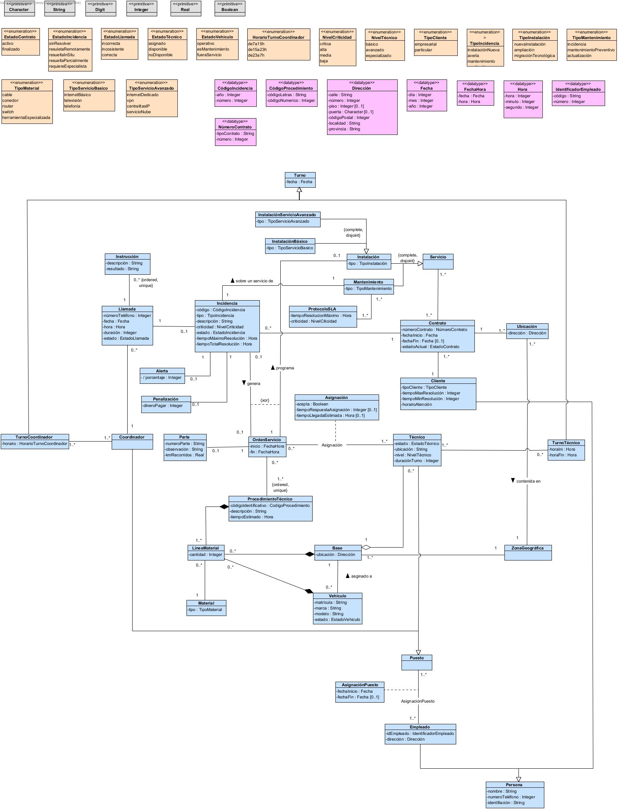
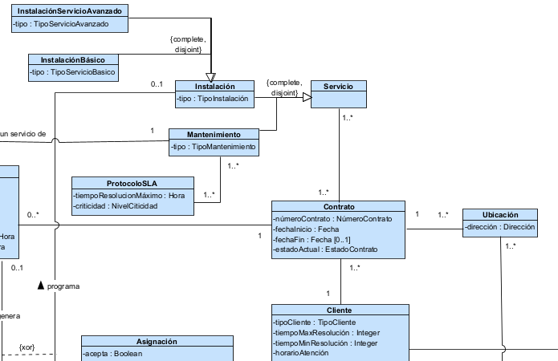
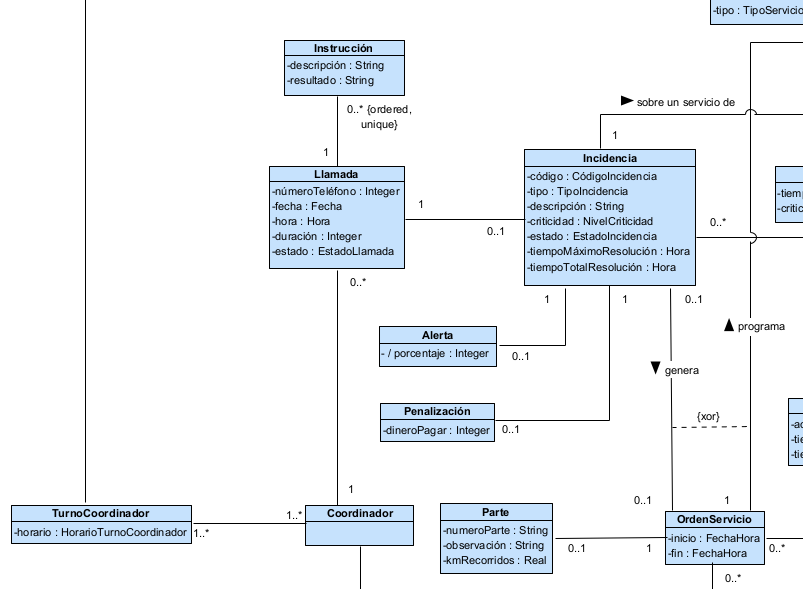
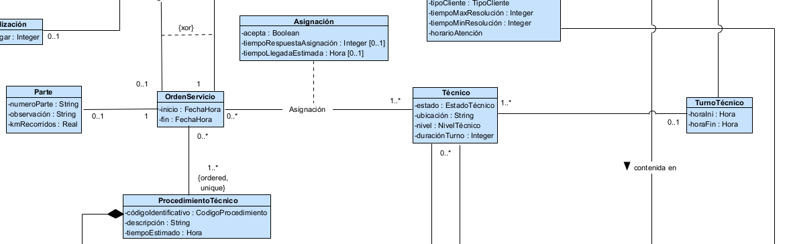
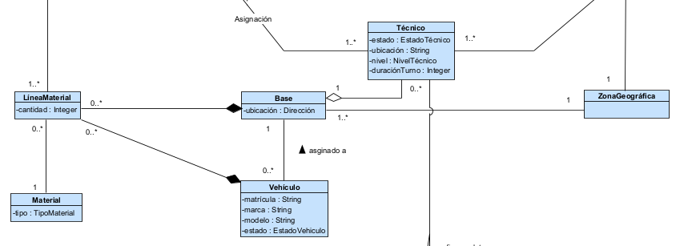
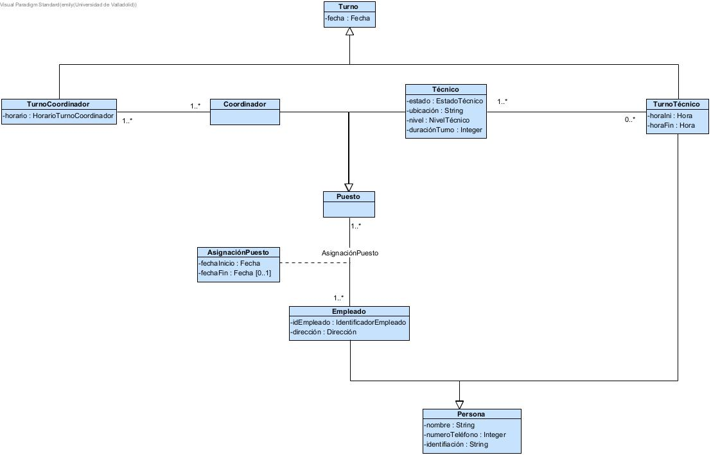

# mod25-equipo14-entrega2
Solución del modelado conceptual de dominio del sistema, basandose en el supuesto planteado para la empresa TCONN-ACME. Este modelado se realiza mediante un Diagrama de Clases en UML.

## Autoras
**Equipo 14**
- Elisa Martínez Lafuente
- Emily Fabiana Rodrigues Álvarez

## Modelado Conceptual de Dominio
 

## Gestión Cliente y Contrato
 

Esta parte del diagrama se centra en la información estática de la empresa: los clientes, sus contratos y los servicios que tienen contratados.

- El sistema deberá almacenar información sobre los **contratos** en particular: el nº de contrato, su fecha de inicio y fin en caso de que haya finalizado y el estado actual del contrato.
- El sistema deberá almacenar infromación sobre los **clientes**, que tienen un contrato con la empresa, en particular: su tipo, particular o empresarial, los tiempos máx. y mín. de las resoluciones y el horario de atención sobre las incedencias.
- El sistema deberá almacenar información sobre las **ubicaciones**, ya que cada contrato puede tener mas de una ubicación, en paticular: la dirección, la cual es un datatype.
- El sistema deberá almacenear información sobre los **servicios** contratados para cada contrato, estos dividen en mantenimiento e instalación. Es necesario recalcar que un cliente particular solo puede contratar servicios básicos, mientras que el empresarial puede contratar servicios avanzados. Esto es una especificación del enunciado que no puede ser reflejado en el modelado conceptual. Asimismo, los servicios que requieren mantenimiento tienen un *protocolo SLA* específico según el tipo de cliente, servicio, contrato y criticidad.

## Gestión Call Center

Esta parte del diagrama se centra en la gestión de llamadaso: las llamadas, sus incidencias, el coordinador que la recibe y la orden de servicio que posteriormente se envia al técnico (en caso de ser necesario).

- El sistema deberá almacenar información sobre las **llamadas** recibidas en el call center, en particular: el numero desde el que se realiza la llamada, la fecha y hora de la llamada, el motivo y la descripción del problema.
- El sistema deberá almacenar información sobre las **incidencias** generadas a partir de las llamadas, en particular: el código de incidencia, su tipo, descripción, criticidad, estado y el tiempo maximo y total de resolución.
- El sistema deberá almacenar información sobre los **coordinadores** que reciben las llamadas. Este es una generalizacion de empleado, por lo que hereda sus atributos.
- El sistema deberá almacenar información sobre las **órdenes de servicio** que se generan a partir de las incidencias y que es la que se pasa a los técnicos para que resuelvan las incidencias, en particular: la fecha de inicio y fin.

## Gestión Ordenes de Servicio

Esta parte del diagrama se centra en los técnicos y las ordenes de servicio que reciben.

- El sistema deberá almacenar información sobre los **técnicos** que realizan las órdenes de servicio, en particular: su estado, ubicación, nivel y la duración de su tuno. Además este es una generalización de empleado, por lo que hereda sus atributos.
- El sistema deberá almacenar información sobre las **órdenes de servicio** que reciben los técnicos, en particular: la fecha de inicio y fin. Además una orden de servicio tiene una clase asociación con técnico que almacena si el técnico ha confirmado la orden y la fecha y hora de dicha confirmación. Asimismo, la orden de servicio puede deberse por una incidencia o por una instalación (esto puede verse más claramente en **[Modelado Conceptual de Dominio](#modelado-conceptual-de-dominio)**, en las asociasciones con *Incidencia* e *Instalación*).
- El sistema deberá almacenar información sobre los **partes** que se genera al finalizar cada servicio, en particular: el codigo de parte, las observaciones y los kilómetros recorridos.
- El sistema deberá almacenar información sobre los **procedimientos técnicos** los cuales estan estandardizados, en particular: el código identifiactivo, su descripción, su tiempo estimado y los materiales necesarios.

## Gestión Base
 

Esta parte del diagrama se centra en la gestión de las bases.

- El sistema deberá almacenar información sobre las **bases** de la empresa, en particular: su ubicación y la zona geográfica en la que si sitúa.
- El sistema deberá almacenar información sobre los **vehículos** que hay en cada base, en particular: su matrícula, marca, modelo y estado.
- El sistema deberá almacenar información sobre los **materiales** que se encuentran en cada base, en particular: el tipo y su cantidad.
- El sistema deberá almacenar información sobre los **técnicos** asignados a cada base.

## Gestión Empleados 
 

Esta parte del diagrama se centra en la gestión de los empleados de la empresa.

- El sistema deberá almacenar información sobre los **puestos** de la empresa, en partciular: de cada empleado la fecha en la que ese puesto fue asignado.
- El sistema deberá almacenar información sobre los **Personas** que será una generación de empleado y cliente, por lo que ambos heredan sus atributos, en particular: su nombre, teléfono y identificador.
