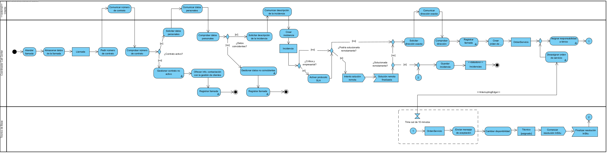
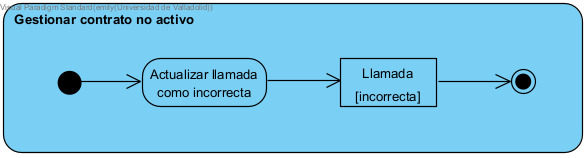
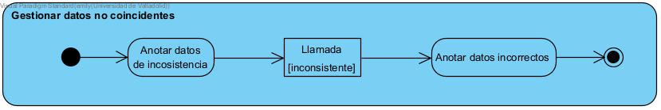
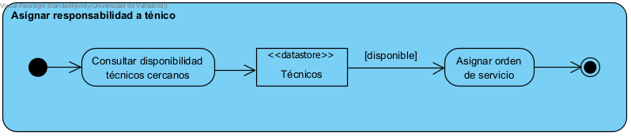
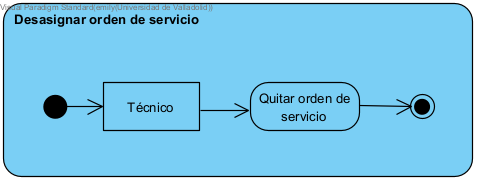
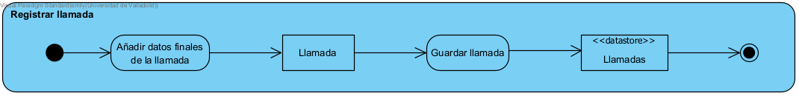
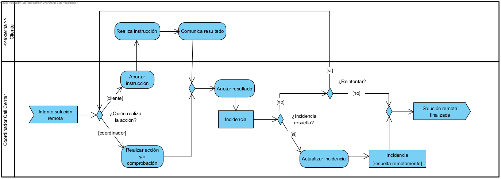
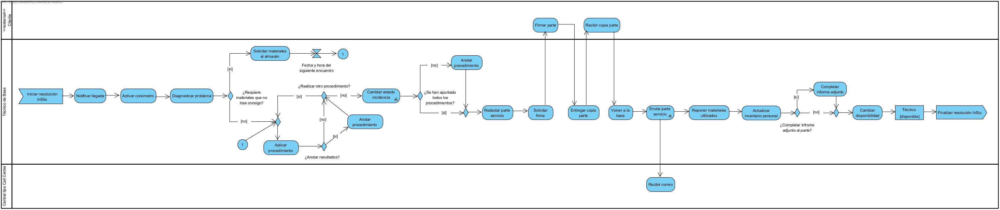
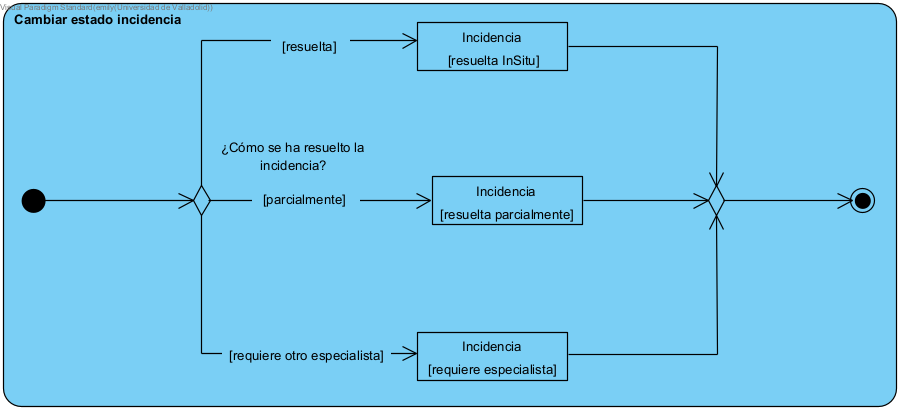
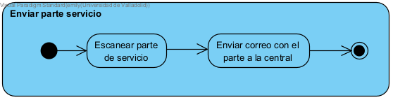

# mod25-equipo14-entrega1
Solución al supuesto planteado para la empresa **TCONN-ACME**, dedicada a la prestación de servicios técnicos de internet y telecomunicaciones.  

## Autoras 
**Equipo 14**
- Elisa Martínez Lafuente
- Emily Fabiana Rodrigues Álvarez

## Diagrama de actividad: Gestión de llamada e incidencia
 
Este tiene tres usuarios; el coordinador del Call Center, el técnico de base y el Cliente que realiza la llamada, este es externo ya que no interactúa directamente con el sistema.

El proceso comienza cuando el coordinador acepta la llamada y procede a pedirle sus datos y los del contrato al cliente. 

Si se comprueba que el contrato no está en vigor, se inicia una actividad compleja que detalla los pasos a seguir.
 

Si se comprueba que el contrato está en vigor, pero los datos proporcionados por el cliente en la llamada no coinciden con los del contrato, se inicia la siguiente actividad compleja. 

Cuando se establece el tipo de incidencia (activando o no el protocolo SLA, activado cuando la incidencia crítica es de un cliente empresarial), el coordinador intenta a resolverlo de manera remota. Este proceso se encuentra en el diagrama de actividad **[Diagrama de actividad: Solución Remota](#diagrama-de-actividad-solución-remota)**.

Sino puede resolverlo remotamente (bien sea por la descripción o por los intentos del coordinador), transmitirá la responsabilidad a un técnico adecuado mediante la siguiente actividad compleja.

Si el técnico no acepta la orden de servicio en máximo 10 minutos, el coordinador debe reasignar la orden de servicio (ver imagen inmediatamente inferior). Es decir, primero debe desasignar la orden, y transmitir la responsabilidad a un nuevo técnico (ver imagen inmediatamente superior).

Una vez que un técnico acepta la orden de servicio antes del tiempo establecido, el técnico realiza la resolución In-Situ. Este proceso se encuentra en el diagrama de actividad **[Diagrama de actividad: Solución In-Situ](#diagrama-de-actividad-solución-in-situ)**.

Cuando el técnico finaliza la solución In-Situ (bien sea porque la ha completado o no) le avisa al coordinador para que pueda registrar la incidencia y dar por finalizada la gestión de la llamada.

Tanto si la llamada es sobre un contrato activo, contiene datos incosistentes o se trata de un cliente y contratos válidos se registra la llamada (después de añadir ciertos datos según sea el caso) mediante la siguiente actividad compleja.

 ## Diagrama de actividad: Solución Remota
 

 Este nuevo diagrama incluye la lógica de resolver la incidencia remota, que se activa únicamente mediante la señal de "Intento de resolución remota" desde el  **[Diagrama de actividad: Gestión de llamada e incidencia](#diagrama-de-actividad-gestión-de-llamada-e-incidencia)**. 

 En este caso, el coordinador puede dar instrucciones al cliente y/o intentar resolver la incidencia el mismo. 

 El coordinador termina la solución remota, independientemente de si pudo resolver la incidencia o no.

 Y se vuelve al **[Diagrama de actividad: Gestión de llamada e incidencia](#diagrama-de-actividad-gestión-de-llamada-e-incidencia)** con el envío de señal "Solución remota finalizada"

## Diagrama de actividad: Solución In-Situ

Este tiene tres usuarios; el técnico de base, la central del Call Center y el Cliente que tiene la incidencia, este es externo ya que no interactúa directamente con el sistema.

El proceso comienza cuando se recibe la señal de iniciar la resolución In-Situ que se activa desde el **[Diagrama de actividad: Gestión de llamada e incidencia](#diagrama-de-actividad-gestión-de-llamada-e-incidencia)**.

Al llegar al punto de servicio se procede a notificar la llegada y activar un conómetro de control. Tras iniciar el registro, se procede a diagnosticar la incidencia con el fin de comprobar si se dispone de los materiales necesarios para su resolución.

En caso de no contrar con los materiales necesarios, será necesario regresar al almacén para su recogida y volver en la siguiente cita acordada.

Una vez tiene lo necesario, el técnico comienza a aplicar los procedimientos para resolver la incidencia. Cada vez que finaliza uno, decide si desea anotarlo. Se realizaran tanto procedimientos como se requiera.

Cuando ya se han llevado a cabo todos los procedimientos, se cambia el estado de la incidencia, valorando cual ha sido su estado tras aplicar los procedimientos. Lo que se explica en la siguiente actividad compleja.

Cuando todo está anotado, el técnico redacta el parte de servicio, el cual tiene que firmar el cliente al que se le entrega una copia.

Al volver a la base, se envia el parte de servicio a la central del Call Center.

Después de esto, el técnico puede o no completar el informe adjunto al parte.

Por último se revisa los materiales que han sido utizados para reponerlos y se cambia la disponibilidad del técnico para que pueda recibir más incidencias, avisándole al coordinador de la central que ha finalizado la solución In-Situ mediante el envío de señal "Finalizar resolución InSitu" hacia **[Diagrama de actividad: Gestión de llamada e incidencia](#diagrama-de-actividad-gestión-de-llamada-e-incidencia)**.